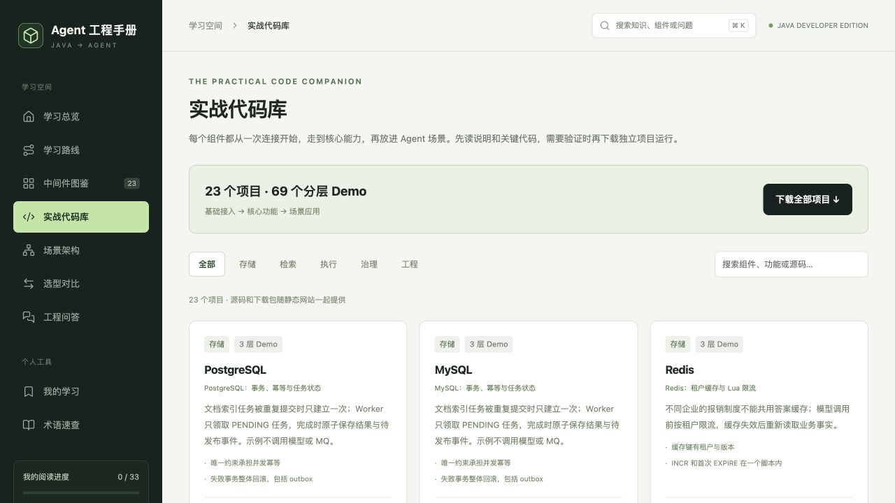

# Agent 工程手册

面向 Java 研发的 Agent 与中间件学习网站，围绕 **架构设计、基础接入、核心功能和排障** 组织内容。通过说明、流程、完整代码和场景理解工程实践，不设置考试、答题或积分。

**33 篇文章 · 23 个独立 Maven 项目 · 69 个分层 Demo · 4 个场景架构**

网站是纯静态 HTML、CSS 和 JavaScript。阅读、搜索、组件对比、笔记和进度均在浏览器完成，无需业务服务端、模型 Key 或中间件。



## 开始使用

项目名为 `java-agent-handbook`。下载或克隆仓库后，在项目根目录执行：

```bash
npm start
```

打开 [http://127.0.0.1:8080](http://127.0.0.1:8080)。需要 Node.js 22+，**无需 `npm install`**。按 Ctrl+C 停止；端口冲突可执行 `PORT=8081 npm start`。

`npm start` 会先自动生成下载包、版本表和发布目录，再启动预览。若只需要单独更新下载包：

```bash
npm run export:demos
```

阅读页面不要求 Java；运行 Java Demo 时，需要 JDK 17+、Maven 3.6.3+，以及对应章节列明的外部服务。ZIP 使用 Node.js 内置能力生成，无需安装 `zip` / `unzip`。首次克隆后，执行 `npm run build` 可同时准备完整站点发布目录和下载包。

**在线阅读入口**：部署后见本仓库 About 中的 Website，或 [GitHub Pages 部署记录](../../deployments?environment=github-pages)。从第三方下载的源码副本请回到原仓库查看入口。

## 适合谁，能学到什么

适合熟悉 Java 后端、希望系统理解 Agent 开发，以及希望补齐检索、异步任务与生产治理能力的同学。建议具备基本的 HTTP、SQL 和 Maven 使用经验。

- **基础与学习路线**：Agent / Workflow / RAG、Java 技术栈、工具调用、上下文和可靠性。
- **存储与检索**：PostgreSQL、MySQL、Redis、对象存储、MongoDB、Neo4j、ClickHouse、pgvector、Milvus、Elasticsearch。
- **任务执行与治理**：Kafka、RocketMQ、RabbitMQ、Temporal、Nacos、模型网关、可观测性。
- **AI 与工程能力**：文档解析、Embedding、Reranker、沙箱、效果评测、Worker 镜像部署。
- **场景架构**：知识助手、业务操作 Agent、研究 Agent、生产架构；按流程展开对应组件的核心代码。

网站还提供全文搜索（Ctrl/Cmd + K）、组件对比、工程问答、术语速查，以及本地收藏、已读记录和笔记。工程问答用于直接阅读设计与排障解释；“评测”讲生产系统质量保障。

## 怎样学与运行 Demo

1. 先沿“学习路线”建立 Agent、工具、检索和任务状态之间的关系。
2. 在“中间件图鉴”理解组件职责、使用条件、选型取舍和常见故障。
3. 打开“实战代码库”，按“基础接入 → 核心功能 → 场景应用”阅读和运行。
4. 选择贴近工作的场景，理解多个组件之间的数据契约、权限和失败边界。

每个项目提供完整源码、依赖、环境变量、运行命令、预期结果、排障和官方资料。下载单项目 ZIP，解压后在该项目根目录执行章节中的命令；全部项目也可在生成后的 `dist/demos/agent-middleware-demos.zip` 中取得。

场景页引用各独立项目的真实源码，**还需要在实际应用中装配**。阅读前先看运行前提：部分步骤使用教学数据或模拟业务，部分会访问真实中间件或云服务。云服务需自行准备对应地域、权限与凭据，并可能产生费用。

## 验证范围与版本

Java 示例使用 `--release 17` 编译。每个项目的依赖版本、编译环境、验证时间和运行范围见 [兼容性与验证状态](docs/compatibility.md)，页面及下载项目也显示验证边界。

- **编译通过**：验证 Java 语法和依赖 API，不代表已经连接真实服务。
- **离线运行检查**：只覆盖记录中的本地 fixture，不等于完整服务联调。
- **外部服务联调**：没有对应记录时，按未验证处理；部署前核对服务版本、配置及官方文档。

编译和运行记录分别保存，并关联源码哈希；源码变化后，旧记录不能证明新代码可用。

## 静态部署

执行 `npm run build` 后，将 **`.cache/site/` 内的全部内容** 上传到任意静态托管平台。该目录由文件清单生成，包含网站和下载包。无需在托管端安装 Node.js、Java 或数据库。

GitHub Pages 的部署工作流会生成下载包并发布 `.cache/site/`。维护者首次使用时，在仓库 **Settings → Pages → Build and deployment → Source** 选择 **GitHub Actions**，再运行工作流；具体维护与发布步骤见 [维护手册](docs/maintaining.md)。

站点使用 Hash 路由，例如 `#/lesson/redis`，可部署到仓库子目录，无需服务端路由重写。请通过 HTTP/HTTPS 打开；直接双击 `index.html` 的 `file://` 访问无法正常加载 ES Modules。

## 本地记录与隐私

网站没有后端账号、分析埋点或模型调用。笔记、收藏和进度保存在浏览器 `localStorage`，按协议、域名和端口隔离。

- `localhost:8080` 与 `127.0.0.1:8080` 的记录相互独立，建议固定地址。
- 清理站点数据会删除记录；更换浏览器、地址或端口前，请在“我的学习”导出 JSON 备份。
- 导入会合并收藏和已读；同篇笔记以导入文件为准。
- 源码下载使用同站静态文件；官方资料链接需联网，外部网站适用各自的隐私规则。

## 贡献与反馈

欢迎纠错、补充排障、改善阅读体验，或提交有明确场景和验证范围的 Demo。开始前请阅读 [贡献指南](CONTRIBUTING.md)；内容问题和功能建议可使用仓库 Issues 中的模板。

```bash
npm run build           # 导出源码/ZIP、更新版本表，生成 .cache/site
npm run check           # 构建后检查内容、源码、下载与结构
npm run verify:demos    # 编译 Maven 项目；需要 JDK、Maven 和依赖下载网络
npm run verify:runtime  # 运行明确列出的离线 fixture
npm run check:security # 检查 Git 已跟踪文件和全历史中的疑似密钥
```

日常内容源位于 `dist/data/*.js`。`dist/demos/` 是生成物，不接受直接修改；编辑数据源后重新导出。完整目录、维护命令和发布流程见 [维护手册](docs/maintaining.md)。

## 许可证与第三方内容

本项目自有网站代码、教程和 Demo 使用 [MIT License](LICENSE)，允许学习、修改、分享和商业使用，需保留版权及许可声明。

第三方产品、文档、商标和 Maven 依赖仍适用各自条款，详情见 [第三方说明](THIRD_PARTY_NOTICES.md)。安全问题请按 [安全报告方式](SECURITY.md) 私下反馈，勿在公开 Issue 中粘贴密钥或敏感数据。
